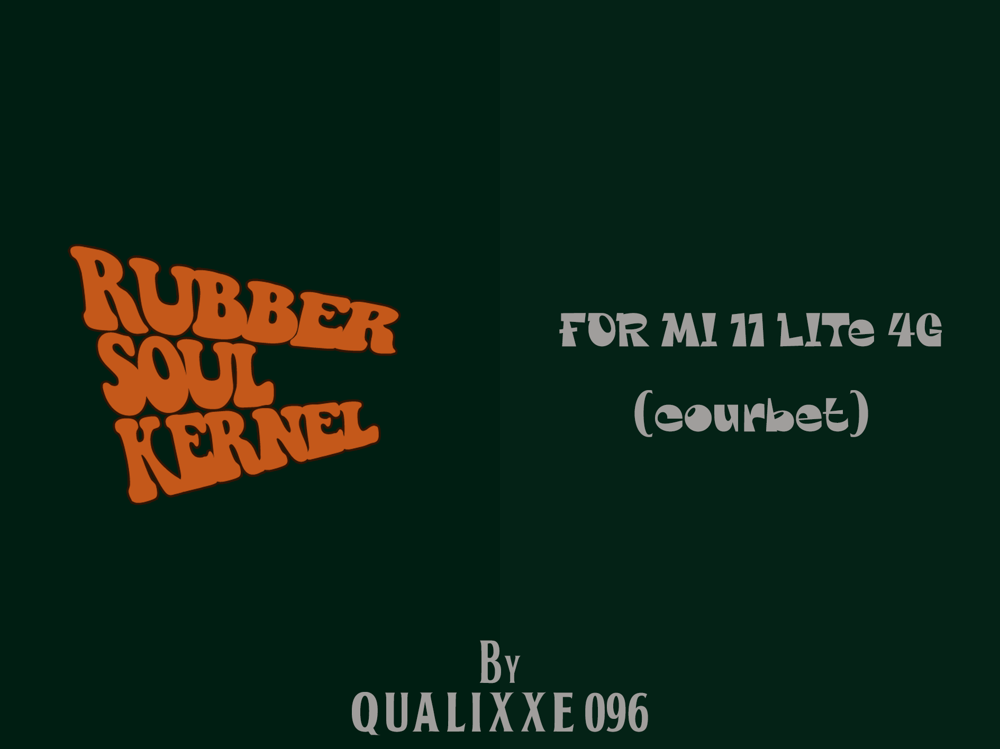

# Rubber Soul Kernel

> *In my life, I've loved them all...*

Stock 4.14 kernel for **Xiaomi Mi 11 Lite 4G (courbet)** for MIUI / HyperOS stock ROMs.
Built from the only official Xiaomi OSS branch: `MiCode/Xiaomi_Kernel_OpenSource @ courbet-r-oss`.

## Side A — what it is

- Source: `courbet-r-oss`, defconfig `courbet_user_defconfig`
- Toolchain: clang-r416183b (clang 12) + gcc 4.9 / 4.9, from LineageOS GitHub mirrors
- Output: AnyKernel3 flashable zip `rubber-soul-courbet.zip`

## Side B — tracklist (build)

1. Actions → **Build Rubber Soul kernel (courbet)** → Run workflow
2. Wait ~15–25 min
3. Take `rubber-soul-courbet.zip` from artifacts

## How to flash

Boot into TWRP / OrangeFox, flash the zip, reboot. The installer patches `boot` in place, system is untouched.

Only for **courbet / courbetin** on stock-based ROMs (MIUI / HyperOS).
Always keep a backup of stock `boot` — *you've got to hide your backups away*.

## Norwegian Wood (notes)

- Base is Android R OSS; HyperOS courbet runs Android 13 on the same 4.14 tree.
- If it doesn't boot restore stock `boot` and open an issue with `build-kernel.log`.
